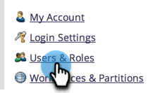
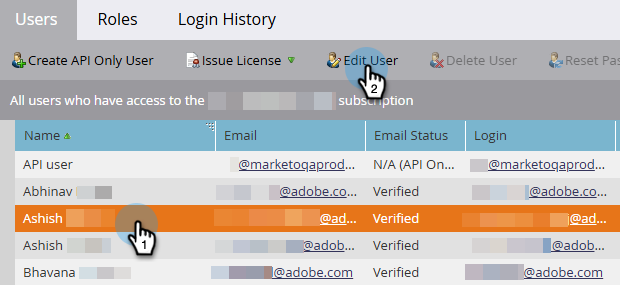
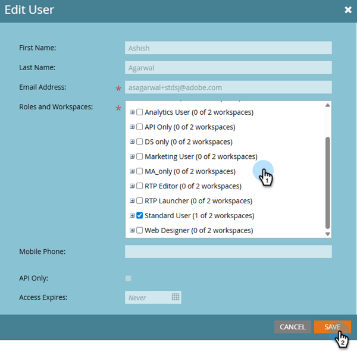

# Editar Espaços de Trabalho de Usuário {#edit-user-workspaces}

1. Em Meu Marketo, clique em **[!UICONTROL Administrador]**.

   

1. Clique em **[!UICONTROL Usuários e funções]**.

   

1. Selecione o usuário desejado e clique em **[!UICONTROL Editar Usuário]**.

   

1. Faça as alterações desejadas e clique em **[!UICONTROL Salvar]**.

   
